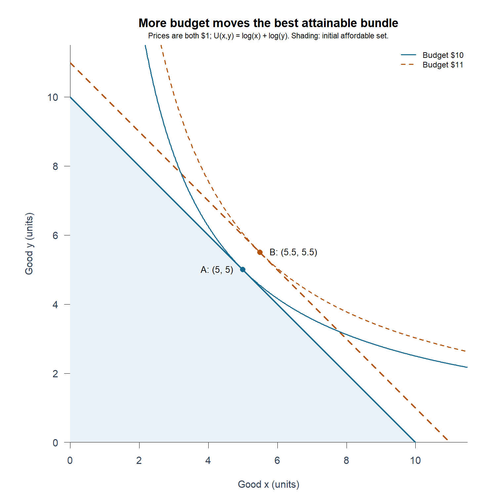
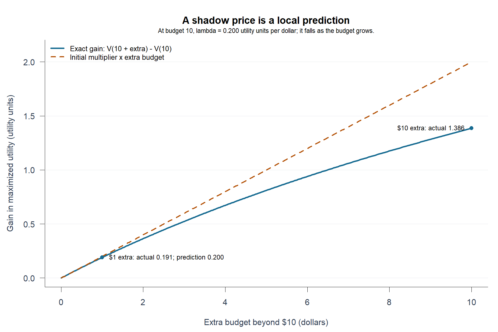

```{r}
#| label: setup
#| include: false
post_dir <- dirname(normalizePath(knitr::current_input(dir=TRUE), mustWork=TRUE))
source(file.path(post_dir,"scripts","analysis.R"), local=knitr::knit_global())
f <- function(x) sprintf("%.3f",x)
```

**You have found the best shopping basket for a \$10 budget. Someone offers you another dollar. Must you solve the entire problem again to know how much better off you can be?** And if a Lagrange multiplier already answers that question, how can a symbol introduced merely to enforce a budget know the value of extra income?

That is the puzzle. The optimal basket tells us **what to choose**; the multiplier tells us **how valuable relaxing the limit would be**. This distinction matters whenever a decision maker must decide whether obtaining more of a scarce resource is worthwhile. But calling the multiplier a “price” can mislead: it is a local improvement in the objective, not necessarily a dollar-valued benefit.

## A basket, a boundary, and an unexpected number

Suppose two divisible goods each cost \$1. Choose positive quantities to maximize:

$$
U(x,y)=\log x+\log y,\qquad x+y\le I.
$$

This is a hypothetical example, not household data. More of either good raises utility, so the budget is exhausted. With the sign convention

$$
\mathcal L=\log x+\log y+\lambda(I-x-y),
$$

the first-order conditions are $1/x=\lambda$, $1/y=\lambda$, and $x+y=I$. Thus:

$$
x^*=y^*=I/2,\qquad \lambda^*=2/I.
$$

At \$10, the best basket is (5,5), and $\lambda=0.2$. Strict concavity makes this the unique global optimum, rather than merely a stationary point.

{#fig-budget fig-alt="Budget lines x+y=10 and x+y=11 touch their respective highest attainable log-utility curves at (5,5) and (5.5,5.5). The initial affordable set is shaded."}

At A in @fig-budget, the two goods offer the same marginal utility per dollar. Otherwise, shifting spending toward the better bargain would improve the basket. An extra dollar therefore earns the common marginal return $\lambda$, regardless of which good receives the next tiny increment.

## Why the helper becomes a shadow value

Write the best attainable utility as $V(I)=U(x^*(I),y^*(I))$. Differentiating along optimal choices gives:

$$
V'(I)=U_x\frac{dx^*}{dI}+U_y\frac{dy^*}{dI}
=\lambda\left(\frac{dx^*}{dI}+\frac{dy^*}{dI}\right)=\lambda.
$$

The final equality follows because optimal spending rises one dollar when income rises one dollar. The changes in the basket do matter, but their contributions combine into one number. This is the envelope insight: under appropriate smoothness and optimality conditions, we can value a small relaxation without separately tracking every adjustment.

Here we can verify it directly:

$$
V(I)=2\log(I/2),\qquad V'(I)=2/I=\lambda^*.
$$

## Why “one more dollar” is only an approximation

The surprise has a second layer: $\lambda=0.2$ does **not** promise exactly 0.2 more utility for a whole extra dollar. It gives the slope at the current budget:

$$
V(I+\Delta I)-V(I)\approx\lambda(I)\Delta I.
$$

From \$10 to \$11, the exact gain is $2\log(11/10)=$ **`r f(comparison$exact_gain[2])`**, close to the predicted **`r f(comparison$marginal_prediction[2])`**. From \$10 to \$20, the prediction is **`r f(comparison$marginal_prediction[3])`**, but the actual gain is only **`r f(comparison$exact_gain[3])`**. As resources grow, the multiplier falls; at \$20 it is 0.1.

{#fig-gain fig-alt="The exact utility gain 2 log((10+extra)/10) is concave. The initial shadow-value prediction 0.2 times extra budget is its tangent at zero and overstates larger gains."}

@fig-gain shows why multiplying today's shadow value by a large expansion overstates its benefit in this example. The multiplier answers a marginal question, not an unlimited promise.

## Read the units before using the number

Our multiplier has units of **utility per dollar**. Multiplying the utility function by ten leaves every chosen basket unchanged but multiplies $\lambda$ by ten. Utility scales are arbitrary, so this number cannot measure dollar willingness to pay or compare happiness across people. If the objective were profit in dollars, its shadow value would instead have dollar-based units.

Nor does “binding” universally imply a positive multiplier. For a differentiable inequality problem satisfying the usual optimality conditions, a slack constraint has zero multiplier; a binding constraint can also have zero marginal value. This log-utility example has a positive multiplier because additional income is valuable at every finite budget. Reversing the constraint's algebraic sign also reverses the multiplier's sign convention.
## Takeaway:

The multiplier turns a choice problem into a marginal valuation problem. Ask what resource is relaxed, what units the objective uses, and how small the proposed change is. Those three questions make the extra symbol economically meaningful.

Figures and numerical checks are generated by the [R script](scripts/analysis.R); the [README](README.md) explains replication. For background on the consumer problem and indirect utility, see [Levin and Milgrom, *Consumer Theory* (2004)](https://web.stanford.edu/~jdlevin/Econ%20202/Consumer%20Theory.pdf).
