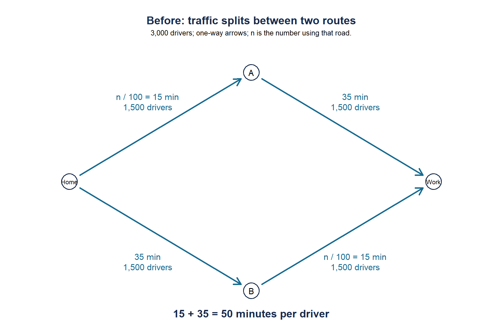
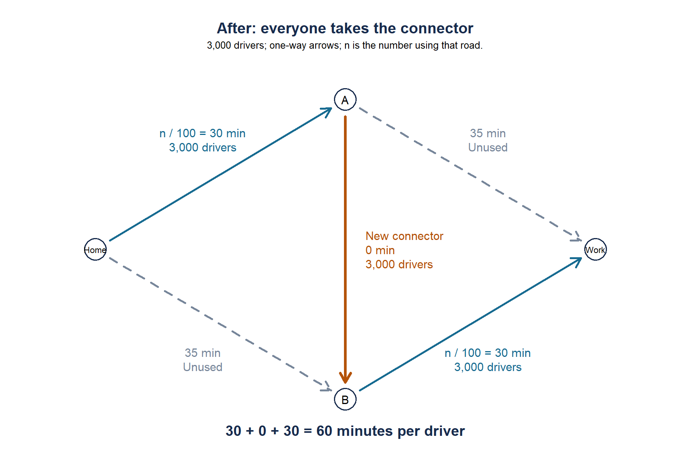

```{r}
#| label: setup
#| include: false
post_dir <- dirname(normalizePath(knitr::current_input(dir=TRUE), mustWork=TRUE))
source(file.path(post_dir,"scripts","analysis.R"), local=knitr::knit_global())
minutes <- function(x) format(x, trim=TRUE, scientific=FALSE)
```

**How can everyone choose their fastest available route, yet a new road leave them all with a slower commute?** A shortcut seems harmless: drivers gain an option and can ignore it. But when everyone responds to that opportunity, their choices change the congestion everyone faces.

This is a puzzle about **Nash equilibrium**: a set of choices in which no individual can benefit by changing their own choice while everyone else keeps theirs unchanged. In our traffic example, this means no driver can shorten their commute by switching routes alone.

Yet, as we will see, an equilibrium can leave every driver worse off than another feasible arrangement.

## First, test whether anyone would switch

Imagine 3,000 drivers travelling from Home to Work during the same commuting period. Each chooses the route that gets them there fastest. There are two options: Home–A–Work and Home–B–Work.

Home–A and B–Work become slower as more drivers use them. On either road, travel time is

$$
t(n)=\frac{n}{100}\text{ minutes},
$$

where $n$ is the number of drivers using that road. The other two roads each take 35 minutes regardless of traffic. This hypothetical network adapts the example in [Easley and Kleinberg, chapter 8](https://www.cs.cornell.edu/home/kleinber/networks-book/networks-book-ch08.pdf), using different numerical values.

Suppose 1,500 drivers take each route. Each congestion-sensitive road takes 15 minutes, so everyone reaches Work in **`r minutes(before_time)` minutes**.

Would anyone benefit from switching? If one driver changes routes while everyone else stays, the other route's congestion-sensitive road carries 1,501 drivers. That road now takes 15.01 minutes, making the driver's total journey **50.01 minutes**. Staying takes 50. The same reasoning applies to every driver, so nobody benefits from switching alone. **The equal split is therefore a Nash equilibrium.**

{#fig-before fig-alt="Directed diamond network from Home to A to Work, or Home to B to Work. Home to A and B to Work each carry 1500 drivers and take 15 minutes; the other roads take 35 minutes."}

## A new option changes the incentives

Now add a one-way connector from A to B, taking zero minutes for simplicity. At the original equal split, a driver on Home–A–Work can keep Home–A but replace the 35-minute A–Work road with the connector and B–Work. Their journey falls from 50 minutes to about 30. The equal split is no longer a Nash equilibrium: a driver can now benefit by switching alone.

Would that incentive disappear as more drivers switch? There are only 3,000 drivers, so either congestion-sensitive road takes at most 30 minutes, including the switching driver. Someone on the upper route can therefore replace A–Work's 35 minutes with a connector journey of at most 30 minutes. Someone on the lower route can make the corresponding saving by replacing Home–B with Home–A and the connector.

Any driver remaining on an old route can thus shorten their commute. **The only possible equilibrium has everyone using Home–A–B–Work.** Both congestion-sensitive roads then carry 3,000 drivers, giving a journey of **30 + 0 + 30 = `r minutes(after_time)` minutes**.

{#fig-after fig-alt="The same diamond with a zero-minute one-way A to B connector. All 3000 drivers take Home to A to B to Work; both congestible roads take 30 minutes, giving a 60-minute journey."}

## Why is the slower outcome an equilibrium?

If one driver switches back to either old route while everyone else keeps theirs, one congestion-sensitive road still carries all 3,000 drivers, including the person switching. The journey therefore takes **30 + 35 = `r minutes(deviation_time)` minutes**, compared with **`r minutes(after_time)` minutes** for staying. No driver benefits from switching alone, so this arrangement is a Nash equilibrium.

Everyone could travel in **`r minutes(before_time)` minutes** if they returned together to the original equal split. That improvement requires coordinated changes, whereas Nash equilibrium asks whether one person can benefit while everyone else's choices remain fixed. At the equal split, an individual would again save time by taking the connector.

Adding a road has therefore increased everyone's equilibrium travel time, even though the original routes remain available. This is **Braess's paradox**, named after Dietrich Braess's [1968 analysis](https://supernet.isenberg.umass.edu/braess/braess-new.html).

## Takeaway

Nash equilibrium asks whether anyone can improve by changing their choice alone. In this network, no driver can shorten the 60-minute commute by switching routes alone, even though everyone could travel in 50 minutes if they returned together to the original split. A Nash equilibrium can therefore leave everyone worse off than another feasible arrangement. Each driver benefits from switching to the connector while the others keep their routes, but when everyone uses it, both congestion-sensitive roads become more crowded.

[The R script and replication guide](README.md) generate both diagrams, route times and equilibrium checks.
