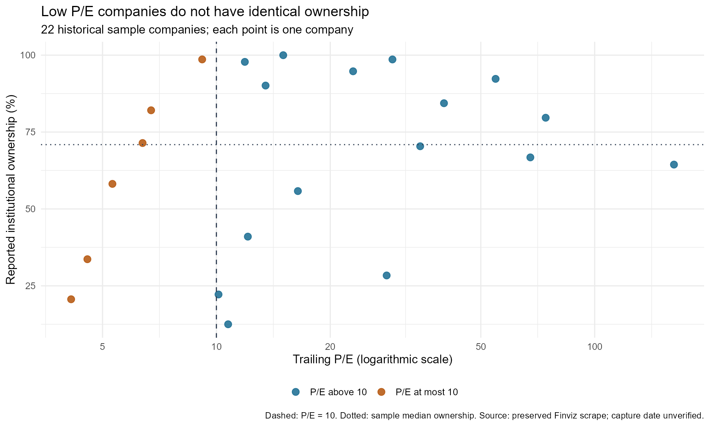

```{r}
#| label: setup
#| include: false
post_dir <- dirname(normalizePath(knitr::current_input(dir=TRUE),mustWork=TRUE))
source(file.path(post_dir,"scripts","analysis.R"),local=knitr::knit_global())
```

**Among the inexpensive-looking companies in this saved sample, do low P/E ratios consistently coincide with high institutional ownership?** The practical question is what to check after a valuation screen. A low price-to-earnings ratio describes price relative to reported earnings; it does not tell us whether those earnings are sustainable. Institutional ownership supplies another descriptive dimension, but is not proof of quality either.

The answer here is **no**: the six companies with P/E at most 10 have reported institutional ownership ranging from **`r sprintf("%.2f",min(shortlist$inst_pct))`% to `r sprintf("%.2f",max(shortlist$inst_pct))`%**. This is a historical research exercise, not a current trading screen or a test of investment returns.

## From web pages to a comparable sample

The original project used **rvest** to read Finviz's public screener tables. Separate views supplied company characteristics, valuation, ownership, and financial fields; the script combined their rows into a CSV. Intuitively, this turns several browser tables into one spreadsheet so that the same company can be compared across measures. The original CSV is preserved unchanged, and this revision reuses it without requesting new screener pages.

That distinction matters. The original HTML and request log were not saved, so the exact capture date and every historical field mapping cannot be independently verified. The file was last modified on September 21, 2026; that is file metadata, **not a verified observation date**. Its predominantly A-prefixed names reflect an alphabetical convenience sample, not random coverage of the stock market.

Before comparing companies, I remove **`r nrow(raw)-nrow(unique_rows)` exact duplicate rows**, leaving `r nrow(unique_rows)` unique names. I then restrict the sample to Finviz's USA classification, exclude ETFs and shell companies, and define the size range explicitly as **USD 300 million to below USD 10 billion**. I retain positive P/E ratios at most 200 and usable institutional ownership percentages between 0 and 100. These rules leave **`r nrow(df)` companies**, including **`r sum(df$low_pe)` with P/E at most 10**. Missing values remain missing rather than becoming zero.

These choices make the comparison interpretable: an ETF is not an operating company, and a missing P/E is not evidence of a bargain. The ownership bounds are a conservative reporting-quality restriction, not a claim that every above-100% vendor report is impossible. Results retaining those reports are saved as a sensitivity check.

The original “ticker” field contains row numbers, so I rename it `source_row_number` and use unique company names only within this fixed snapshot. I also omit the ambiguously labelled short-interest fields. Their positional extraction mixed up measures; treating signed ownership changes as shares sold short would be misleading. Neither issue can be repaired by drawing a more attractive chart.

## What the comparison actually shows

{#fig-screen fig-alt="Each point is one company. Six companies have P/E at most 10; three fall below and three at or above the sample median institutional ownership of 70.905 percent."}

@fig-screen compares both variables **for the same firms**, rather than interpreting separate sector charts as evidence of a relationship. The logarithmic horizontal scale keeps high-P/E observations from crowding the cheaper names together. The vertical cutoff is P/E 10, an illustrative screening rule; the horizontal line is this sample's median institutional ownership, **`r sprintf("%.2f",inst_cut)`%**. Neither threshold establishes fair value or a validated risk category.

```{r}
#| label: low-pe-table
display <- shortlist |>
 mutate(`Ownership relative to sample median`=ifelse(lower_inst,"Below","At/above")) |>
 select(Company=company_name,`Trailing P/E`=pe_num,`Institutional ownership (%)`=inst_pct,`Ownership relative to sample median`)
knitr::kable(display,digits=2,caption="The low-P/E subset: company-level evidence behind the research screen.")
```

Three low-P/E companies sit below the ownership median and three above it. For example, Array Digital Infrastructure has P/E 4.13 and ownership 20.64%, while ADT has P/E 9.17 and ownership 98.61%. Both pass the cheapness rule, but they do not have identical ownership profiles. The table supports this distinction; it does **not** identify undervaluation, institutional approval, or future distress.

## Turn the screen into a research decision

Use the six names as a **historical due-diligence worksheet**, rather than promoting the whole low-P/E bucket as an investment opportunity. For each, check the issuer's statements for recurring earnings, one-off gains, debt obligations, and business risks. For the three below-median ownership names, investigate the ownership structure before assuming institutions endorse them. High ownership does not exempt the other three from those checks.

Changing the P/E cutoff from 10 to 8 leaves `r sensitivity$low_pe_n[1]` names; raising it to 12 yields `r sensitivity$low_pe_n[3]`. This sensitivity, the small nonrandom sample, missing HTML provenance, and differing sector business models rule out market-wide or causal claims. A holdings snapshot alone also cannot establish institutional buying or selling.

**Takeaway:** web scraping can organize a useful research queue, but a low multiple is only the first question. Here it conceals substantial ownership variation. Verify the underlying business and the data definitions before interpreting “cheap” as “good value.”

Definitions follow [Finviz's screener help](https://finviz.com/help/screener). [Current robots rules](https://finviz.com/robots.txt) restrict generic screener queries; this revision makes no new screener requests and does not claim retrospective proof of permission. Full replication details are in the [README](README.md).

## Reproducibility appendix

The article above explains the decisions and evidence; this single folded block contains the complete analysis that generates its numbers, table inputs, figure, and audits. The [original rvest collector](scripts/scrape_original.R.txt) is retained for provenance, **not for automatic rerunning**. The [header-based parser](scripts/parse_saved_html.R) shows how permitted saved HTML should be validated in future work.

```{r}
#| label: full-analysis-code
#| results: asis
#| echo: false
code <- paste(readLines(file.path(post_dir,"scripts","analysis.R"),warn=FALSE),collapse="\n")
for (pair in list(c("&","&amp;"),c("<","&lt;"),c(">","&gt;"))) {
  code <- gsub(pair[1],pair[2],code,fixed=TRUE)
}
cat('<details><summary>Complete reproducible R analysis</summary><pre><code class="language-r">',
    code,'</code></pre></details>',sep="")
```
