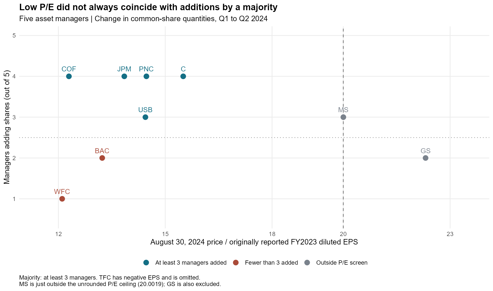
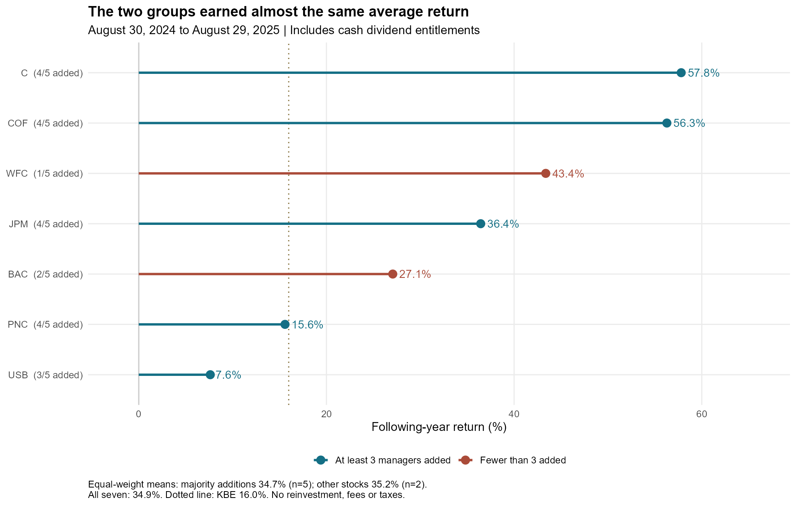

```{r}
#| label: setup
#| include: false
post_dir <- dirname(normalizePath(knitr::current_input(dir=TRUE),mustWork=TRUE))
source(file.path(post_dir,"scripts","analysis.R"),local=knitr::knit_global())
```

**Does a low P/E signal broader institutional buying—and does combining the two identify bank stocks with higher subsequent returns?** I examine this question using a bank-stock screen in August 2024. First, I compare the number of managers increasing their holdings across the qualifying stocks. Then I compare following-year returns for stocks with broader additions, the complete low-P/E list and the stocks the additional condition excludes.

For this historical sample, the extra condition reduced seven candidates to five and left their average return almost unchanged. The individual outcomes show what the narrower list gained and missed.

## Define the stock screen

I examine the ten largest directly U.S.-listed U.S. parent companies in the New York Fed’s [year-end 2023 banking table](https://www.newyorkfed.org/medialibrary/media/research/banking_research/QuarterlyTrends2023Q4.pdf?hash=085DF7EB1CAEE14D2FCC011A20B37FD7&sc_lang=en), excluding TD’s unlisted U.S. subsidiary.

Using R’s **rvest**, I collect public holdings disclosures for **[Vanguard](https://13f.info/manager/0000102909-vanguard-group-inc), [BlackRock](https://13f.info/manager/0001364742-blackrock-inc), [State Street](https://13f.info/manager/0000093751-state-street-corp), [FMR](https://13f.info/manager/0000315066-fmr-llc) and [Geode](https://13f.info/manager/0001214717-geode-capital-management-llc)**. I count how many increased reported common-share quantities between March and June 2024. “Broader buying” means **at least three of five** added. All filings were public before August 30.

**Seven stocks** have positive, originally reported 2023 GAAP diluted EPS and an August 30 price-to-earnings ratio no higher than **20**. This annual-earnings cutoff defines the shortlist; it does not establish undervaluation. [Replication details](README.md).

## Does low P/E come with broader institutional buying?

{#fig-buying fig-alt="Among seven stocks passing the P/E screen, Capital One, JPMorgan, PNC and Citigroup have four managers adding, U.S. Bancorp three, Bank of America two, and Wells Fargo one. Goldman Sachs and Morgan Stanley lie outside the P/E ceiling; Truist has negative EPS."}

Capital One and Citigroup each had **four managers** adding shares, compared with **one for Wells Fargo** and **two for Bank of America**. All seven had at least one manager adding, but only five met the majority condition. A low P/E alone therefore did not tell an investor whether most of these managers were increasing their positions.

The distinction creates a concrete screening decision: keep all seven low-P/E candidates, or keep only the five with broader additions? The narrower list excludes Wells Fargo and Bank of America. Comparing subsequent returns shows whether that exclusion helped in this case. The holding changes themselves record behavior, not the managers’ reasons for it.

## Did broader institutional buying identify higher-returning stocks?

I compare equal-dollar purchases on **August 30, 2024**, held until **August 29, 2025**. Scraped [Digrin prices](https://www.digrin.com/stocks/detail/JPM/price) and [Stock Analysis dividend histories](https://stockanalysis.com/stocks/jpm/dividend/) supply closing prices and cash dividends earned during that window. Dividends are not reinvested; returns precede fees and taxes.

{#fig-returns fig-alt="Majority-addition stocks have equal-weight mean return 34.7%, compared with 35.2% for the other two stocks and 34.9% for all seven. Individual returns range from U.S. Bancorp's 7.6% to Citigroup's 57.8%."}

The **five-stock filtered list returned `r f1(100*selected_return)`%**, compared with **`r f1(100*all_return)`% for the complete seven-stock list**. The two excluded stocks averaged **`r f1(100*other_return)`%**. Selecting the broader-buying stocks therefore produced almost the same average return as keeping the original shortlist, and a slightly lower return than the excluded pair.

The filter retained Citigroup’s **`r f1(100*v("C","return"))`%** gain, but also U.S. Bancorp’s **`r f1(100*v("USB","return"))`%** return. It discarded Wells Fargo, which returned **`r f1(100*v("WFC","return"))`%**. The retained stocks included both the highest and lowest returns among the seven. Broader additions did not separate the stronger performers from the weaker ones in this sample.

## How sensitive is that comparison?

Morgan Stanley’s unrounded multiple is **`r sprintf('%.4f',v("MS","pe"))`**, just outside the screen. Raising the ceiling to 20.01 includes it and puts the majority group ahead, **`r f1(100*cutoffs$selected_return[cutoffs$pe_ceiling==20.01])`% versus `r f1(100*cutoffs$other_return[cutoffs$pe_ceiling==20.01])`%**. This boundary check was added after noticing that near-cutoff stock. It shows that even the direction of the small group difference depends on the precise screen. Seven stocks in one year provide a case study, not a reliable estimate of how the condition would perform across other samples and periods.

## Takeaway

Low P/E did not automatically coincide with additions by most of the five managers. Adding that condition then reduced seven candidates to five without increasing their following-year average return. In this case, excluding Wells Fargo and Bank of America on that basis did not improve the shortlist. The practical lesson is to use institutional holding changes as additional research information, rather than assume they validate a low-P/E investment: the return comparison here provides no basis for that assumption.

*Source extracts, original earnings ledger, complete outcomes, sensitivity checks and offline code: [README](README.md).*
