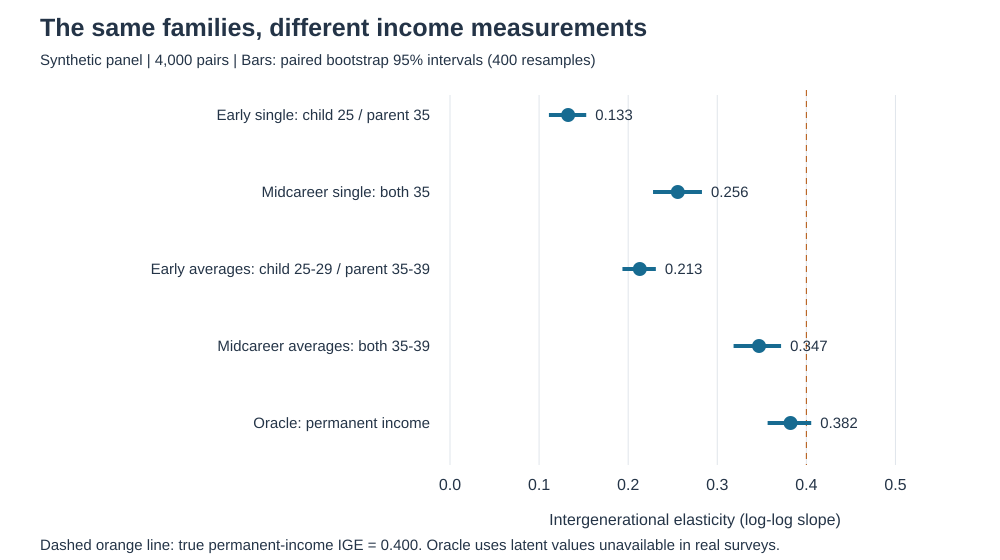
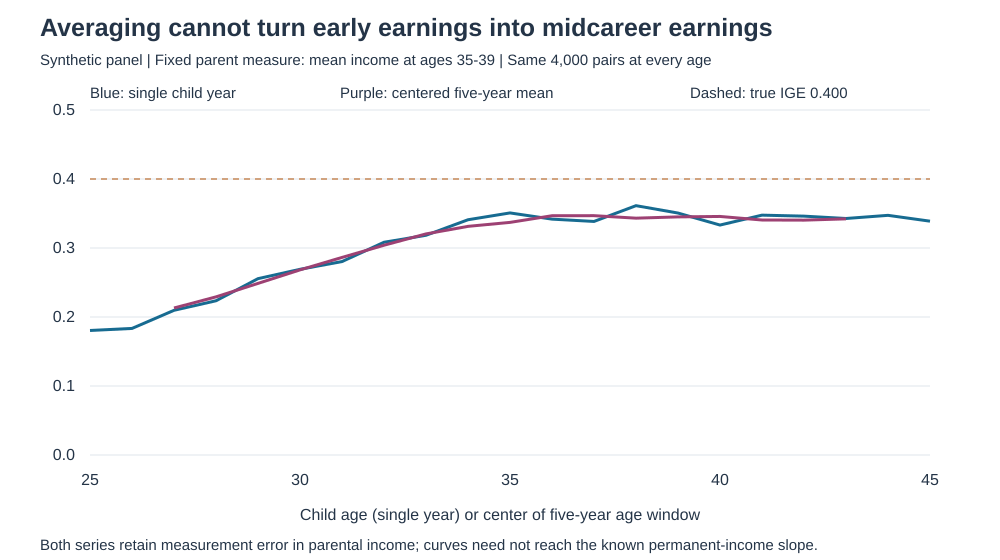

```{r}
#| label: setup
#| include: false
post <- dirname(normalizePath(knitr::current_input(dir = TRUE), mustWork = TRUE))
python <- Sys.getenv("BLOG6_PYTHON", unset = Sys.which("python"))
if (!nzchar(python)) stop("Install Python and numpy; set BLOG6_PYTHON if Python is not on PATH.")
run <- system2(python, shQuote(file.path(post, "scripts", "analysis.py")), stdout = TRUE, stderr = TRUE)
if (!is.null(attr(run, "status")) && attr(run, "status") != 0) stop(paste(run, collapse = "\n"))
est <- read.csv(file.path(post, "results", "estimates.csv"))
fmt <- function(i) sprintf("%.3f", est$ige[i])
```

**Can the same families appear more mobile simply because we observe children too early in their careers?** This tutorial uses Python's SQLite interface to match generations and estimate the intergenerational income elasticity (IGE). Correct links are necessary; comparable income measurements matter too.

All data here are **simulated**, not PSID records or evidence about U.S. mobility. There are 4,000 independent families, each with one parent and one adult child, observed annually at ages 25–45. All income is positive and in constant purchasing-power dollars. The generator sets the permanent-income IGE to **0.400**, providing a benchmark unavailable in real surveys.

## 1. Match people, not current households

Run `python -m pip install -r requirements.txt`, then `python scripts/analysis.py` from this post's folder. The script creates reusable CSV snapshots on first use and loads them into an in-memory SQLite database. It needs no server, API key, or download.

`persons.csv` contains stable `person_id`, `parent_id`, `origin_family_id`, and `current_family_id`. `income.csv` has one row per person-year. Children form new households, so current family IDs cannot identify their parents.

```python
import sqlite3
from pathlib import Path
con = sqlite3.connect(":memory:")
# analysis.py creates the schema and loads the saved CSVs here.
con.executescript(Path("scripts/match.sql").read_text())
```

The first operation in that SQL file is:

```sql
SELECT c.person_id AS child_id, p.person_id AS parent_id,
       c.origin_family_id
FROM persons AS c
JOIN persons AS p
  ON c.parent_id = p.person_id
 AND c.origin_family_id = p.origin_family_id
WHERE c.role = 'child' AND p.role = 'parent';
```

`SELECT` chooses columns; aliases `c` and `p` distinguish two copies of the person table. `JOIN ... ON` links the recorded parent ID and verifies the childhood family. `WHERE` restricts roles. A shared family identifier alone could match the wrong adult. The script enforces unique person-year records and one matched parent per child, and saves six integrity checks. These simulated links are complete; real genealogical identifiers require additional validation.

## 2. Aggregate before joining histories

```sql
SELECT person_id,
       MAX(CASE WHEN age = 35 THEN real_income END) AS income35,
       AVG(CASE WHEN age BETWEEN 35 AND 39
                THEN real_income END) AS mean35_39,
       COUNT(CASE WHEN age BETWEEN 35 AND 39
                  THEN real_income END) AS n_mid
FROM income WHERE real_income > 0
GROUP BY person_id;
```

`GROUP BY` produces one row per person. `MAX` retrieves the unique age-35 observation; `AVG` averages annual income levels; `COUNT` checks coverage. The full query also constructs ages 25–29, requires all five observations, and joins the aggregated parent and child rows to `pairs`. Joining raw five-year histories first would produce 25 rows per pair. Missing observations must remain missing, not become zero.

## 3. Estimate the same model with different measures

For matched pair \(i\), estimate:

\[
\log Y_i^c=\alpha+\beta\log Y_i^p+u_i.
\]

```python
import numpy as np
rows = con.execute(
    "SELECT parent_mean, child_mid_mean FROM matched ORDER BY child_id"
).fetchall()
x, y = np.log(np.asarray(rows, dtype=float)).T
X = np.column_stack([np.ones(len(x)), x])
alpha, beta = np.linalg.lstsq(X, y, rcond=None)[0]
```

An IGE of 0.4 means 10% higher parental income is associated with approximately 4% higher child income. A larger slope indicates stronger persistence, not a causal parental effect. For averaged measures, take **the log of average income**, not the average of log income.

{#fig-measurement fig-alt="Five IGE estimates with bootstrap intervals: early single 0.133, midcareer single 0.256, early averages 0.213, midcareer averages 0.347, and latent-income oracle 0.382; true population slope 0.400."}

@fig-measurement holds the sample fixed. Moving from both generations at age 35 to ages 35–39 averages raises the estimate from **`r fmt(2)` to `r fmt(4)`**, nearer the known 0.400. The latent-income sample slope is `r fmt(5)`, rather than exactly 0.400, because finite samples fluctuate. Intervals resample entire independent family pairs 400 times; they reflect sampling uncertainty, not correction of measurement bias.

## 4. Separate life-cycle bias from yearly noise

{#fig-lifecycle fig-alt="Single-year and five-year child-income IGE curves rise between early adulthood and midcareer, with parent income fixed at its ages 35–39 average. Early five-year averages remain below the true 0.400 slope."}

The generator deliberately makes early earnings less responsive to permanent income: the loading rises from 0.5 at age 25 to 1 at age 35. Independent yearly log-income shocks have standard deviation 0.45. This is an illustrative assumption, not an estimated career profile. With parental measurement fixed, @fig-lifecycle shows lower persistence when children are young: **life-cycle bias**, distinct from noisy parental income attenuating the slope.

Early five-year averages yield `r fmt(3)`, still below the midcareer average's `r fmt(4)`. Averaging reduces independent transitory fluctuations but cannot repair an early-career window. Persistent shocks, attrition, zero earnings, and different age profiles can change the real-data result; more years do not guarantee unbiasedness.

## Takeaway:

match stable identities, aggregate before joining, and compare generations at defensible career stages. Multi-year income can better proxy long-run status, but a precise SQL match does not make poorly timed income a reliable mobility measure.

## Replication:

Replication details and assumptions are in the [README](README.md); complete [Python](scripts/analysis.py) and [SQL](scripts/match.sql) reproduce every result. The simulation is author-generated. For the underlying measurement issue, see [Haider and Solon (2006)](https://www.nber.org/papers/w11943); for the interface, see [Python's sqlite3 documentation](https://docs.python.org/3/library/sqlite3.html).
