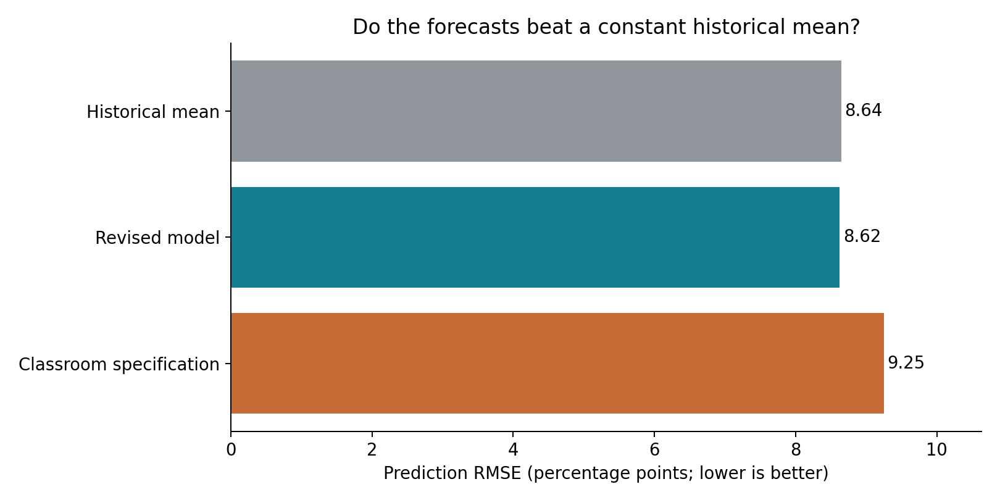
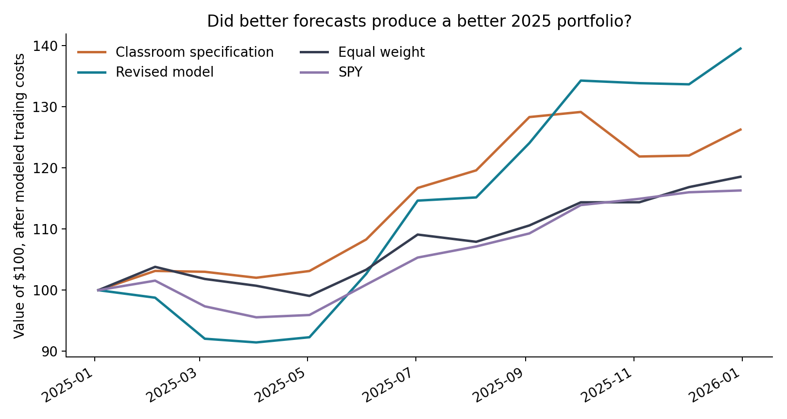

**For the classroom's 95-stock universe, could a revised gradient-boosting model improve both return forecasts and investment performance in 2025?** Our stock game asked whether analysis could improve on intuition. I extend that question by testing a specific prediction model: did better forecasts translate into better investments?

## What the classroom experiment teaches

The [game assignment](data/classroom/assignment.pdf) gave each team two $100,000 portfolios for two months: one based on intuition, the other using financial indicators, optimized weights and/or XGBoost. Across the **45 paired class results**, average returns were **1.18%** and **3.09%**, respectively; the analysis-based portfolio won in **30 teams**. These results describe a mix of approaches, since the workbook does not identify each team's method.

The assignment also presents an XGBoost backtest that beat SPY, an ETF tracking the S&P 500. It cautions that the result may depend on the period and stock universe. The [attached model](scripts/classroom_original.R) predicts returns from momentum, volatility and recent performance, then selects ten stocks. Boosting adds trees sequentially to correct earlier prediction errors; the original uses 300 trees of depth five.

Predicting returns is difficult because historical relationships can change. Stocks share market shocks, and overlapping future-return windows provide less independent information than the row count suggests. Flexible trees can fit patterns that do not persist. I test whether revising this model helps on data excluded from training.

## Make the model less eager to fit

I use cached [Yahoo Finance](https://finance.yahoo.com/) prices for the same 95 stocks over 2022–2025, adjusted for splits and distributions. The revision drops absolute prices and share volumes, adds momentum relative to SPY, and predicts stock returns minus SPY returns. Relative volume divides current volume by its 21-day average. Shallower trees and slower learning limit how aggressively it fits training errors.

I train on 2022–2023 and select among six settings using 2024 alone. Validation chooses **depth 1 and 100 trees**. Both specifications are then refitted on pre-2025 data and tested on 2025. Observations whose outcome windows cross a training boundary are removed. This evaluates the revised procedure as a whole, rather than identifying which change helped.

## Better predictions, but a small edge over simplicity

The forecast target runs from the next trading day's close to the twentieth following close. For the revised model, the training-period average market return converts relative forecasts back to stock-return forecasts.

Figure 1 compares errors across **21,850 stock-date predictions** from January 2 to December 2, 2025. Root mean squared error measures typical forecast error while penalizing large misses. It falls from **9.25 to 8.62 percentage points**. Yet the constant historical-mean forecast scores **8.64**. The revision removes much of the original model's disadvantage, but improves squared error over this simple benchmark by only **0.55%**.

## Did the rankings help an investor?

On each month's first trading day, I rank stocks and buy the top ten in equal weights at the following close. Both model portfolios use equal weights to compare selection, replacing the classroom script's forecast-proportional weights. Positions remain until the next monthly entry; the last portfolio is sold December 31. Both models, the equal-weight 95-stock portfolio and SPY use identical dates. Returns include an assumed **0.10% cost per dollar bought or sold**, including entry and liquidation.

The revised portfolio earns **39.5%**, versus **26.3%** for the classroom specification, **18.6%** for equal weighting and **16.3%** for SPY. It beats the classroom specification by **13.26 percentage points** after assumed costs. Annualized monthly volatility is **19.6%**, compared with **8.9%** for equal weighting: higher returns came with larger fluctuations. The chart records monthly endpoints.

Forecast error evaluates every stock-date prediction; the portfolio uses only the ten highest-ranked stocks each month. A small reduction in average prediction error therefore need not produce a similarly small difference in portfolio returns.

## Takeaway

The revised procedure improved forecasts and investment returns in this 2025 test. Its forecast error was only slightly below the historical-mean benchmark, however, and its portfolio was more volatile than equal weighting. I would test the same fixed procedure on another period before using these results to allocate money. The class game and this backtest make analysis worth investigating; neither establishes a persistent advantage.

[Code, data and replication instructions](README.md) · [Source repository](https://github.com/zhenxin-li/Zhenxin-Li-website)
